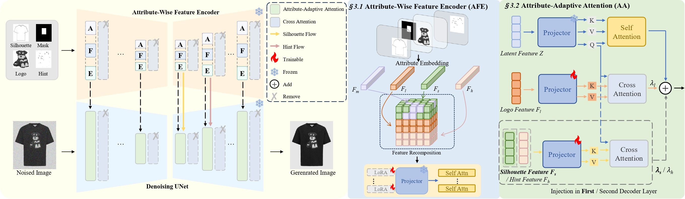

<div align="center">
<h1> IMAGGarment+: Efficient Attribute-Wise Diffusion for Garment Generation </h1>

Jian Yu<sup>\*</sup> , Fei Shen <sup>\*</sup>, Cong Wang , Yanpeng Sun , Hao Tang , Qin Guo , Xiaoyu Du<sup>†</sup>

*These authors contributed equally , †Corresponding author

<a href='https://revive234.github.io/imaggarment.github.io/'></a>
<a href='https://ojs.aaai.org/index.php/AAAI/article/view/38203/42165'></a>
<a href='https://huggingface.co/keimen/IMAGGarment-Plus'></a>
[](https://github.com/revive234/IMAGGarment-Plus)
</div>




## 🔧 Requirements

- Python>=3.8
- [PyTorch>=2.0.0](https://pytorch.org/)
- cuda>=11.8
```
conda create --name IMAGGarment-Plus python=3.8.8
conda activate IMAGGarment-Plus
pip install -U pip

# Install requirements
pip install -r requirements.txt
```
## 🌐 Download Models

Our method is built upon [Stable Diffusion XL (SDXL)](https://huggingface.co/stabilityai/stable-diffusion-xl-base-1.0), using [sdxl-vae-fp16-fix](https://huggingface.co/madebyollin/sdxl-vae-fp16-fix) as the VAE. The pretrained IMAGGarment+ checkpoint is available on [IMAGGarment-Plus](https://huggingface.co/keimen/IMAGGarment-Plus).

## 🚀 How to use
```
conda activate IMAGGarment-Plus
# Training
sh train.sh

# Inference 
sh inference.sh
```

## Citation
```bibtex
@inproceedings{yu2026imaggarment+,
  title={IMAGGarment+: Efficient Attribute-Wise Diffusion for Garment Generation},
  author={Yu, Jian and Shen, Fei and Wang, Cong and Sun, Yanpeng and Tang, Hao and Guo, Qin and Du, Xiaoyu},
  booktitle={Proceedings of the AAAI Conference on Artificial Intelligence},
  volume={40},
  number={14},
  pages={12135--12143},
  year={2026}
}
```
